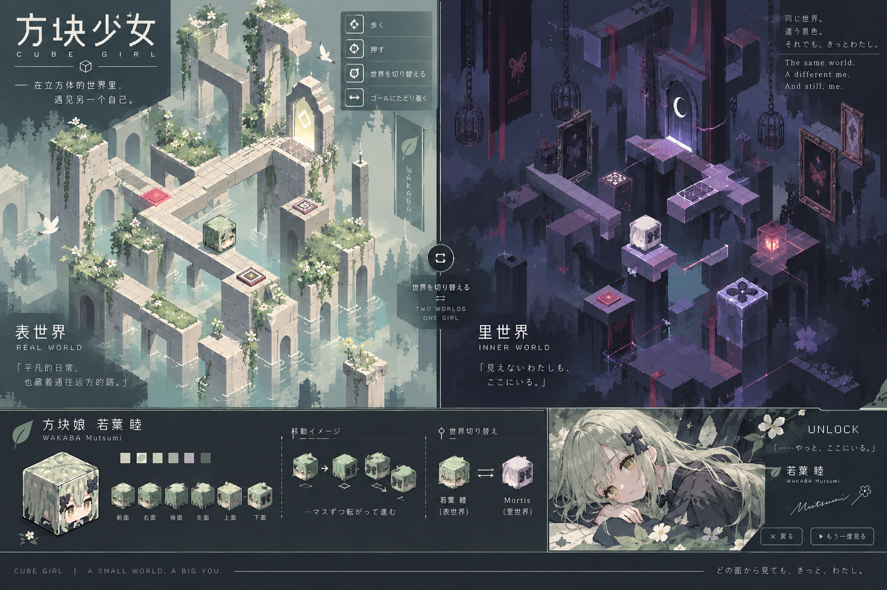
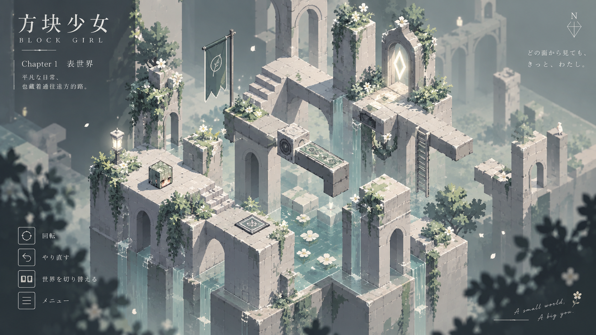
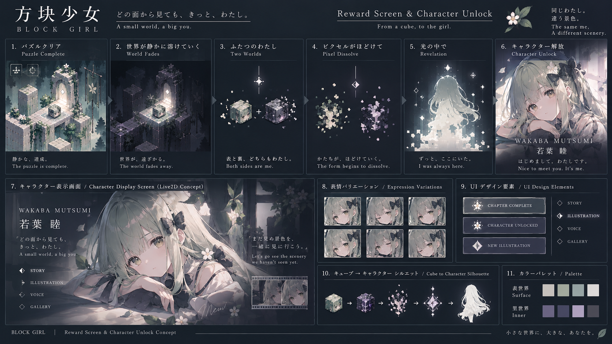
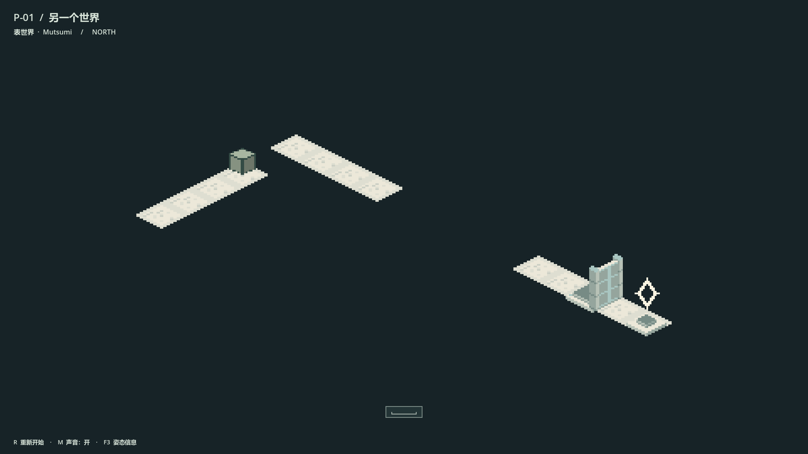
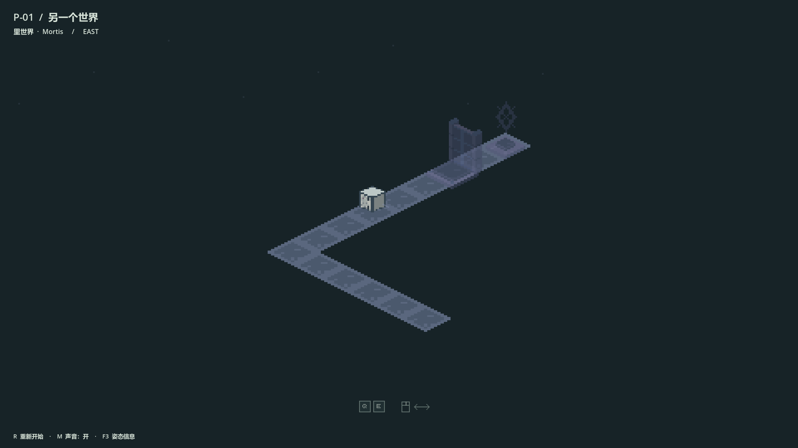
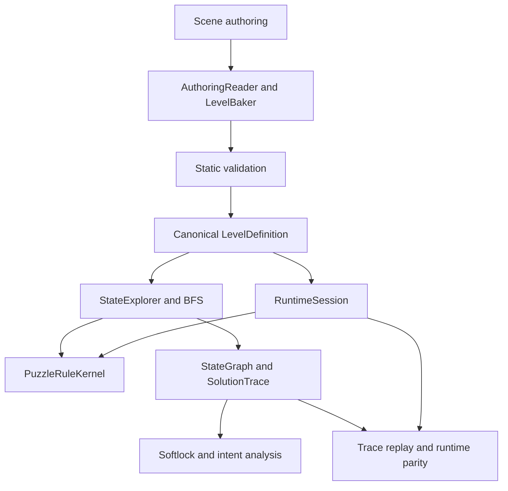

# Mutsumi Veilshift

### 《方块少女：若叶睦》

一个以若叶睦为主题，围绕方块翻滚、表里世界切换、透视连接与空间机关展开的 Godot 空间解谜项目。



*Concept art establishes visual direction; it is not a gameplay screenshot.*

**Godot 4.7 · GDScript · Beta Vertical Slice**

> **Repository status — release branch preparation, 2026-10-11 (Asia/Shanghai)**
>
> This checkout is `release/beta-game-feel-20261010`, based on
> `d1277ec90b5a739efd4862d314e6c29ac5ac1eda`, positioned as a **Beta Vertical Slice**.
> Its release documentation is committed separately from the inherited gameplay.
> Push and the proposed `v0.3-beta-game-feel` tag await explicit confirmation.
> The local audit below describes the preserved development baselines.
>
> Local `main` at `13177bb713c229fd5691c1e53cf5ba4d45f2ff76` contains the integrated
> foundation, three-level Beta content and shell, and approved L01 3D / shell UI.
> It is 150 commits ahead of fetched `origin/main` at
> `8a77874cc18ceb654664c3e9aeb10a2ccd318048`.
>
> Five-level 3D and latest Game Feel work is on `feat/game-feel-full-slice-01` at
> `d1277ec90b5a739efd4862d314e6c29ac5ac1eda`. Its Perspective Fall, yellow TOP
> landing and Forward Drop milestones are not ancestors of local or remote `main`.
>
> Human QA, remaining graphical coverage, L06 playable delivery and complete
> Audio / UI / Art closure are incomplete. No push or release tag has been performed.

完整审计见 [Repository Audit](docs/release/REPOSITORY_AUDIT_REPORT.md)；候选范围、开发节点及待确认推送方案见
[Release Preparation](docs/release/RELEASE_PREPARATION_REPORT.md)。这些状态描述的是审计时本地 refs；远端内容不会因本地文档更新自动同步。

## About / Gameplay

The protagonist moves as a rolling cube: every step changes which physical face
points where. Surface and Inner offer different routes through the same puzzle
space. Authored world shifts, perspective connections and mechanisms determine
which actions are allowed; visual alignment alone does not create a new path.

The first character theme is **Wakaba Mutsumi / 若叶睦**, with an Inner presentation
associated with **Mortis**. The historical P-01 prototype uses pixel-art isometric
presentation; recent local work adds the game shell and 3D presentation.

The Game Feel candidate adds scoped **Perspective Fall** in experimental MAP A/B,
including yellow TOP landing and continuous forward departure. This does not
claim arbitrary optical-illusion solving or Fall integration into every level.

## Concepts and Historical Screenshots





These concepts explore atmosphere and possible reward presentation. Character
unlocks and Live2D presentation shown in the concepts remain visual ideas.





The gameplay images are real historical P-01 pixel captures with debugging hidden.
They do not depict the latest five-level 3D or Game Feel candidate.

## Current Development Status

| Stage | Recorded status / scope |
| --- | --- |
| P-01 | Historical playable puzzle, tutorial, mechanisms and completion |
| FOUNDATION-0–3 | Integrated into local `main`; contracts, spatial model, rules, validation, solver and runtime parity |
| FOUNDATION-4 | Partial implementation / receipts; Core frozen for Beta, advanced authoring deferred; editor branch remains outside candidate |
| Beta Content / Game Shell | Three-level content and shell, approved L01 3D / shell UI on local `main` |
| Five Level 3D Slice | Recorded in candidate ancestry; not promoted to local `main` |
| Perspective Fall / Forward Drop | MAP A/B receipts; latest focused ten-case matrix records 10 PASS |
| Human QA / Human Feel | Incomplete; latest Forward Drop handoff records NOT_RUN |
| Wider Game Feel matrix | Historical 94 cases retain 54 PASS / 40 PENDING |
| Audio / UI / Art closure | Partial; scoped deliveries do not establish complete closure |
| Release preparation | Beta Vertical Slice branch created; push and tag await confirmation |

Focused Graphical TraceReplayer runs passed in the latest Forward Drop receipts.
Earlier bridge blockers were partly resolved by later commits. Remaining matrix,
lifecycle/input and presentation coverage is not promoted to PASS by those runs.
This audit summarizes recorded evidence and does not rerun Godot or playtesting.

Next steps are Human QA on the exact candidate package, remaining graphical /
Audio / UI / Art closure and approval of the release scope. L06 playable content
and advanced editor tooling remain separate integration decisions. L06 playable
delivery is incomplete and excluded from this slice. No release date
is promised.

## Architecture

The integrated foundation uses shared semantic evaluation for runtime and search:



Cube orientation has 24 discrete legal states. Search uses complete state identity.
Budget exhaustion does not prove unsolvability; definitive softlock results require
a complete graph. The diagram does not imply all editor orchestration is complete.

## Project Structure

```text
foundation/  Spatial model, rules, validation, solver and runtime
game/       Levels, shell, player input and presentation
prototype/   Historical prototype systems
production/  Character, environment, UI and audio resources
tests/      Development validation and evidence
tools/      Authoring / build support
docs/       Design, development records and release audit
project.godot
```

The candidate also contains `experiments/` and `production/experimental/`.
Preserving its ancestry includes those materials and historical validation sources.

## Getting Started / Controls

1. Choose a branch and verify its SHA against the release report. GitHub `main`,
   local `main` and the Game Feel candidate currently differ.
2. Import that checkout's `project.godot`. Recorded validation used **Godot 4.7.2
   on Windows / D3D12 / Forward Plus**. Allow asset imports to finish.
3. Use Godot's **Run Project** action.

Audited local `main` starts `game/shell/game_shell.tscn`; the candidate starts
`game/shell/game_feel_shell.tscn`. Source-playable packages require external Godot;
standalone executables and other-platform support are not claimed.

| Input | Historical P-01 action |
| --- | --- |
| WASD / Arrow keys | Roll in screen-relative directions; hold to continue |
| Space | Shift between Surface and Inner |
| Q / E | Rotate view by 90 degrees |
| Left mouse button + horizontal drag | Rotate view |
| R | Reset level |
| M | Toggle master audio mute |

Follow the candidate's exact build handoff for shell and MAP A/B controls. State
and transition rules determine when actions can begin. Historical developer keys
F3 / F4 toggle debugging / visual-effect comparison.

## Development Branches

| Branch | Audited scope |
| --- | --- |
| `origin/main` | Published baseline at `8a77874` |
| local `main` | Three-level / L01 3D / UI baseline at `13177bb`; 150 ahead |
| `feat/game-feel-full-slice-01` | Five-level / Game Feel candidate at `d1277ec`; 325 ahead of `origin/main` |
| `integration/foundation-4-authoring` | Earlier PFALL handoff baseline, not latest Forward Drop |
| `release/beta-game-feel-20261010` | Created from `d1277ec`; release documentation added; push / tag pending |

Local `main` has one QA documentation commit outside the candidate; the candidate
has 176 commits outside `main`. Exact included / excluded commits and Worktrees
are inventoried in the release reports.

## Fan Project Disclaimer

Mutsumi Veilshift is an **unofficial fan-made project**. Wakaba Mutsumi, Mortis,
MyGO!!!!!, Ave Mujica, BanG Dream! and related characters or trademarks belong to
their respective rights holders. This project is not affiliated with or endorsed
by the official rights holders.

## License

Source-code licensing is being prepared. No repository-wide `LICENSE` is provided
in the audited baseline. Character IP and third-party materials are not covered
by a future source-code license unless explicitly stated. Runtime and concept
images do not establish blanket permission to reuse all assets.
