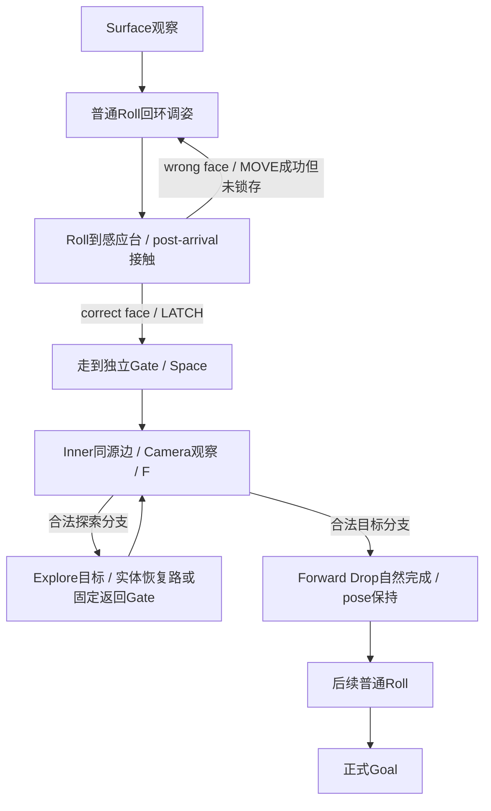

# 六面归位-第一批综合实验

> [!important] 独立实验，当前未验收
> ID `rubik_spatial_puzzle_01`，名称《六面归位》。STEP 4是四机制集成验收，不是第五机制，不注册为L06/L07/L08。状态IMPLEMENTATION_IN_PROGRESS；本页采用合同7442e817与接口5664a32，未宣称正式地图已集成或Godot PASS。

## 认知目标与难度

玩家应能解释“先调姿→接触锁存→到转换站主动切换→观察分流→落地继续滚动”。难度来自一个计划需要跨过三个地点、保留一个已锁存成果，再做一次明确视角选择，而不是同时收集十类状态。

该实验应在玩家分别接触四个labs后解锁或至少可任选回看；目前是实验入口策略，不新增正式Game Shell进度门。第一次完整通关观察是否能预测最后一次到台的面与分流目标，而非只测动作速度。

不加入Face Imprint/World Echo/Camera Echo/Landing Twist/Edge Touch/完整姿态复合Goal。综合目标是本批正式Goal；不能为了“归位”名称擅加pose11、印章或跨世界回声等旧WSG-B要求。

## 初态、目标和作者节点职责

初态：Surface Spawn、作者initial Orientation与Camera、Face Lock initial_state、转换门未解锁；全部取09正式Baker结果。目标：从Goal路线经正式Roll到达声明Goal，正确world/Face按现有合同判定。

| 设计符号 | 必要职责 | 禁止混用 |
|---|---|---|
| S Spawn | 安全起点，可观察传感台/门/Goal地标 | 不假设出生自动触发ENTER锁 |
| L Loop | 双向调姿环与两条同台路线 | 不用原地人工设pose取代 |
| T Sensor | 普通Roll到达的Face Lock；required_local_face由09与01实际记录确定 | 不兼Shift/Fall/FaceTransition目标 |
| G Gate | 独立转换点；required_mechanism_states要求T.latched | 不检查视觉灯、不自动切世界 |
| G′ Inner arrival | UNIQUE SAME_NORMAL合法Shift目标 | 不兼ENTER传感台 |
| F Source edge | Inner同一Face/edge的正式U_NEG请求 | 不能Host选择target或用隐藏实体路覆盖Fall |
| X Explore target | 合法探索支路，接通可恢复路线 | 不能只有Reset才能逃离 |
| Y Goal-route target | 合法目标支路，有后续普通Roll路 | 不能落点直接人工置Goal |
| R Return | 探索支路的合法返回站/可走路，回到可再次选择的位置 | 不开放全地图Space作为修补 |
| Z Goal | 正式稳定到达判定 | 不擅自新增未声明姿态/印章条件 |

这些是地图职责而非真实Face ID/坐标。当前Root检查时尚无09 maps目录；09负责后续正式地图、五视图、每世界四Camera连通表、Source/Target条件与真实见证。未确定坐标时不编造“已交付五视图”或沿用WSG-A/B图冒充本关。

## 可用操作与机制序列

WASD/箭头按正式屏幕mapper执行普通Roll；Q/E按现有四Camera；F仅请求U_NEG；Space仅当前合法Gate；Reset回完整作者初态；H/按钮主动请求进阶提示。没有新USE_LOCK、TOUCH、手动选target或World Echo动作。

预期机制序列：

1. 在Surface看见T需求面、G锁定与终点地标，确认G当前不能Space。
2. 用L调整姿态，计算从L到T的最后一段Roll，不能只看环出口朝下面。
3. 经普通Roll到T：错面到达不激活；正确post-arrival接触在同一MOVE中LATCH，离台后状态保持。
4. 走到独立G，主动Space；真正Shadow/Mapping/Safety仍需满足，保持Orientation和Camera。
5. 在Inner走到F，切换观察方向，比较作者标出的配对目标与后续路线；按F由正式Runtime唯一选target。
6. 自然Forward Drop完成落地，pose保持；继续普通Roll沿目标路线到Z，才由正式Goal完成。

具体动作数/方向/pose/Camera/Face IDs只有正式map_factory.witnesses与Runtime见证到达后追加。当前没有以纸面序列充当正式可执行解。允许重复环、原路撤销、先观察再返回、合法探索支路等替代顺序；不要求唯一解。

## 基础提示与主动进阶提示

| 阶段 | 默认基础提示 | H/按钮主动进阶提示 | 默认不显示 |
|---|---|---|---|
| 观察 | “标记面要接触感应台，点亮后开放对应转换站。” | “到台的最后一次滚动也会改变接触面。” | 完整方环步序与绕圈数 |
| 调姿 | “同平台不同路线会留下不同朝向。” | “先比较两条到同台的路径；原路反向可撤销。” | 指定pose ID答案 |
| 接触 | 所需local_face与当前接触面；正式latched/initial状态 | “错面也能站上；离开后重新滚到台上再判断。” | 一键补激活或USE键 |
| 入里 | G的目的世界、锁态、单/双向与Space | “离开感应台后锁存仍在，走到转换站再确认。” | 自动Shift或远程Space |
| 分流 | 标记源边、当前合法配对、F含义 | “比较支路的返回站与目标地标，再决定视角。” | 默认显示Camera B正确答案 |
| 归位 | “坠落保持姿态；下一次普通Roll才再改变。” | 只展示当前合法后续路与恢复点 | 默认见证动作列表 |

高级提示可按需更深，但由H/按钮显式请求；同级提示不能把内部statekey/数字错误码当玩家教程。反馈文字+物理面图标/线型，不单靠颜色。

## 失败、Reset与局部恢复

| 尝试/中断 | 正式结果 | 正常恢复 |
|---|---|---|
| 普通位置Space | Gate not found，state不变 | 找标记站，继续可走路线 |
| G未解锁Space | Gate locked，state不变 | 回T调姿后再来；不丢进度 |
| 错面Roll到T | MOVE成功，锁仍initial | 离台，经L调整，再Roll到T |
| 已锁存后离T | latch保持到Reset | 可自由规划去G，无需再站台维持 |
| Camera非法的F | 无合法Fall或原正式拒绝，state不变 | 在F改视角/观察；不反复随机按Space |
| 选探索Camera的F | 合法到X，不是失败 | X有正式可走路或R站回到再次选择的位置 |
| Surface源非Shadow/目标不安全 | 保留真实原权限/Safety拒绝 | 由作者设计可恢复构型；不能提示玩家“无视规则强切” |
| Shift/Fall/Camera中Reset | generation取消旧pending，回初态 | 自然重玩，旧完成回调不得恢复旧world/latch |
| 已完成后Reset | Goal清除，全部作者初始状态恢复 | 完整重走；不靠仅换场景皮肤 |
| Continue | 现有隔离存档语义回本关起点 | 不宣称恢复尚未版本化的中途门/pose状态 |

X→R→可再选择点的每条边和每次Shift必须走正式规则；R可用固定返回Gate，反向条件独立声明。不允许“走错即死/仅Reset”被当作可恢复支路，不用Echo或任意位置Space补洞。

## 组合关系与认知链

探索回路箭头是必要设计职责，不是已经存在的几何边证明；09需落到实际Face/Gate/道路并给Baker与Runtime见证。

## 验收请求与趣味检查

正式见证必须包含真Loop、正确Face Lock、解锁Gate的SHIFT、同边Camera资格Fall、自然Forward Drop、后续普通Roll、Goal。再记录Reset后通关、至少一条不同合法序列、错面/锁门/非法Camera拒绝，以及探索支路恢复。

Solver、Safety、Replay、Graphical、Integration各由其实际证据决定；Human QA为NOT_RUN直到真人操作记录到达。抽象旧WSG-B的54态/9动作与本关无对应，绝不搬作本关解长或Softlock证据。

体验重点：玩家能否在进L之前说出计划；能否区分T锁存和G转换；能否根据线索选支路；错面后是否知道回环能修正。若只靠随机按键通关，先检查未授权捷径、过度直给的提示与缺乏视觉因果；不能只延长地图。

## 舍弃方案与下一步

旧候选的USE_LOCK激活、在门上直接要求某面、普通roll透视分流、Echo印章复合Goal，都未进入此第一批实现。选择ENTER latch是为了让姿态与到达成为一个原子因果；独立Gate保留玩家Space时机；Fall分流复用真实Forward Drop。

先等待09正式地图/见证和00/01/03的分项证据，追加实际差异、失败案例与验收。此页不启动新机制开发或重做正式五关。关联 [[四机制第一批-规则与教学]]、[[四机制第一批-验收与差异记录]]、[[00-机制设计总览]]。

## 实际实现与完整图收据追加｜2026-10-11 19:35

前文是原设计和最初待验收状态，本节追加新实测。实际地图ID `rubik_spatial_puzzle_01`，作者提供真实Baker记录，不是测试替身或手工设置姿态。路线为Surface普通Roll闭环→RIGHT local_face接触传感器锁存→回source合法转换Gate主动Shift→Inner Camera限定的同源U_NEG Fall→普通Roll到Goal。探索B支路通过另一条正式Fall返回source，之后取A到Goal；World Echo没有在本关自动转换角色。

已核对09 `combined_runtime_02` 原始report/process：103检查、exit0、stderr空、source_drift=[]、doubles=[]；运行HEAD `0f26b64956c6b055f5f1ead49e7b8aee1146d0f8`，2026-10-11 19:22:39启动、19:31:14结束（Asia/Shanghai）。完整正式BFS图908状态/3916边，graph.complete=true、filtered_edges0、safety_unproven_rejections0；正式Softlock status0/softlock_count0/reset_recoverable_count0。未锁存进入Inner的图中绕过数0；逻辑Replay mode0匹配7/7，divergence_step=null。最短解7步；shortest_solution_count_complete=false，不能写唯一解。LevelHash `5b4de9ca172f39ea537ceb00f3f56074d83f136cc768c66b9f4669764187d2c8`。

[完整图与逻辑Replay原始报告](附件/集成验收核对-20261011-193546/证据快照/block-girl-spatial-map-01/maps/evidence/combined_runtime_02/report.json)、[执行收据](附件/集成验收核对-20261011-193546/证据快照/block-girl-spatial-map-01/maps/evidence/combined_runtime_02/process.json)。报告含wrong_face/correct_face/solution_east/solution_south真实见证。地图/Foundation记录的72项摘要与本轮Root8d58b3a对应（允许Git换行转换），不把后来Runtime/Host修改当成该运行重测。

00五地图自然图形208检查中，本关EAST/SOUTH两条路线实际完成，使用真实Host、自然动画、正式Goal与最终姿态；Reset后再执行另一条路线。00正式生产mode1 headless Bridge在本关匹配7步、每步一次completion/commit和完整StateKey；它仍是headless节点证据。本关Windows正式Graphical TraceReplayer、菜单完整玩家操作和独立Build尚未取得最终收据，Human NOT_RUN。03 mechanics_01的combined.mechanic_load/order/runtime_lifecycle共141断言通过（1+126+14），属于独立行为覆盖，不替代完整图或图形Replay。

首次 `combined_runtime_01` 的300秒TIMEOUT、checks0和缺最终report永久保留。新的完整图执行耗时486313ms（Solver部分），已获得最终PASS_OWNER收据，因此此前“完整图INCOMPLETE/Softlock NOT_VERIFIED”在本LevelHash的09逻辑图范围内被本节新结果更新；旧超时记录不删，也不解释成无解。独立03综合Core/图形最终矩阵、01边界修复合并后的回归与Build仍待收口，整体不是ALL_QA_PASS。

完整证据分层与旧失败见[[四机制第一批-验收与差异记录]]；[本轮文档追加校验](附件/集成验收核对-20261011-193546/文档追加校验.json)只验收笔记与快照追溯，不运行Godot。

Godot changes: NONE

Push: NOT_RUN

## 正式图形Replay与最终技术验收追加｜2026-10-11 20:08

《六面归位》保持已作者的四机制顺序：Surface回环正确RIGHT接触锁存→回合法Gate主动Shift→Inner同源边按Camera分流→真实Forward Drop→普通Roll→Goal。原8动作A/13动作可恢复B见证与Solver最短7动作分别保留；作者见证包含显式Camera请求，不能与最短步数混淆。

新增03 `combined_graphical_01`：165检查、exit0、stderr0、drift=[]、doubles=[]、capture/source_verified=true，在Windows正式生产TraceReplayer mode1中把原selected FIRST_SHORTEST trace重复两次；两次均7/7完整匹配、divergence_step=null。执行candidate/HEAD `dee229c76f48b2fa3dbfaaa30bebed7e982f63ce`，已消费01最终b78d07c。此为本关真正新Graphical Replay证据，取代“Windows mode1未有收据”的当前待验状态；此前headless45仍是headless历史证据。

[165项正式图形报告](附件/集成验收核对-20261011-200826/证据快照/block-girl-spatial-quality-01/quality/evidence/combined_graphical_01/report.json)、[真实进程](附件/集成验收核对-20261011-200826/证据快照/block-girl-spatial-quality-01/quality/evidence/combined_graphical_01/process.json)。本关独立 `combined_selected_03`62检查通过：实际Baker、selected Solver witness、selected Safety边、预算拒绝、Runtime native提交、mode0 Replay；这不是第二份908节点完整图。全图无软锁/未锁Inner绕过0仍引用09 combined_runtime_02的908/3916正式完整图，不添加虚假的03独立全图断言。

03五图natural_all_01的882检查中，综合自然姿态/生命周期项目通过，包含正常与可恢复支路Goal、Pause/Resume、原生Reset取消、重复输入/持键单提交、Camera不改物理pose、scene exit卸载和无延迟完成。全run数882不写成本关独享882。07三尺寸菜单/实际综合入口与反馈图形同样有证据，属于UI和入口覆盖，不能替代本关完整通关证明。

01最终修复现已正式交付b78d07c，1393项Core/受影响回归通过；已有idle/latched地图的行为/图拓扑不变由交付审查明确，长图没有以最终SHA重跑。03本关selected与正式图形路线已消费最终依赖；这些新检查与09原完整图分别引用，不能改写旧进程HEAD。

技术状态：已验证范围内SOLVER/LOGICAL Replay、selected SAFETY、正式GRAPHICAL Replay、自然路线/生命周期具备PASS收据；最终复制包仍 **FINAL_PACKAGE_VERIFICATION_PENDING**，Human NOT_RUN。03矩阵未跑项、最终包源SHA/启动/旧关派生UID验证和真人学习效果不写PASS。所有旧TIMEOUT、observer/资源泄漏和不合法fixture尝试留在验收页及附件。

[本轮分层验收](四机制第一批-验收与差异记录.md)、[证据核对清单](附件/集成验收核对-20261011-200826/证据核对清单.json)、[追加校验](附件/集成验收核对-20261011-200826/文档追加校验.json)。

Godot changes: NONE

Push: NOT_RUN

## 最终可玩包闭环追加｜2026-10-11 20:18

本关已包含于实际最终包 `E:/godot/beta-sprint-builds/beta_spatial_puzzle_batch_01_20261011_01`，从[project.godot](E:/godot/beta-sprint-builds/beta_spatial_puzzle_batch_01_20261011_01/project/project.godot)在Godot4.7.2中F5，或[play.ps1](E:/godot/beta-sprint-builds/beta_spatial_puzzle_batch_01_20261011_01/play.ps1)启动并从五入口选择《六面归位》。源SHA `26603d532154dbf1a7fb9cea475a55b206a40cb6`。

00包启动/1467文件hash/150UID、三尺寸219、独立Cold Continue11和旧五关206全部取得实际PASS收据；本关状态更新为 **PLAYABLE / BUILD_PASS_SOURCE_PLAYABLE（已验技术范围）**，此前FINAL_PACKAGE_VERIFICATION_PENDING仅作历史。既有908/3916完整图、softlock0/bypass0、mode0 7/7和Windows正式Replay165证据保留；不声称最终包另重跑长图。03最新自然947/机制500属于五图共享最终断言，不能全部计成本关。

98项矩阵保留10NOT_RUN：五项Human、四项冗余独立FIRST_SHORTEST、综合关独立全边权限census。综合完整图继续明确引用09正式结果，03没有假装补做该census。旧TIMEOUT/失败、全部早期计数不删除或累计。

[最终包闭环与ZIP身份](附件/Build闭环-20261011-201838/证据核对清单.json)、[[四机制第一批-验收与差异记录]]最终节。HUMAN_QA=NOT_RUN；08真实包交接中，不能写真人理解PASS。

Godot changes: NONE

Push: NOT_RUN
