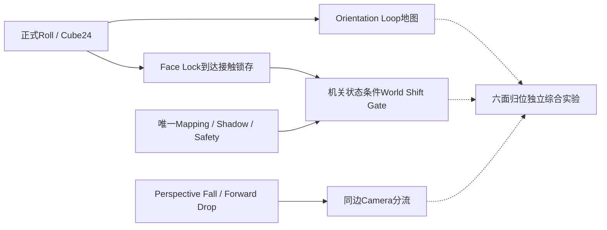

# 四机制第一批-规则与教学

> [!important] 第一批实现合同，不等于十候选均已实现
> 本页只收束World Shift Gate、Orientation Loop、Face Lock、Perspective Fork及它们在《六面归位》中的组合。执行状态 **IMPLEMENTATION_IN_PROGRESS**；无本轮Godot/Solver/Safety/Replay/Graphical PASS。原十候选仍保留DESIGN_PROPOSAL，World Echo、Face Imprint、Camera Echo、Landing Twist、Edge Touch等不随本批进入实现。

## 权威来源与适用层

- [用户全流程任务](E:/godot/worktrees/block-girl-spatial-puzzle-batch-01/docs/beta-sprint/spatial-puzzle-batch-01/USER_REQUEST.md)定义本批范围和Owner。
- [00共享合同](E:/godot/worktrees/block-girl-spatial-puzzle-batch-01/docs/beta-sprint/spatial-puzzle-batch-01/CONTRACT.md)，固定提交`7442e8172e865d093ff1e73570d891f60d9134af`。
- [01精确接口](E:/godot/worktrees/block-girl-spatial-puzzle-batch-01/docs/beta-sprint/spatial-puzzle-batch-01/RUNTIME_INTERFACE.md)，固定提交`5664a32a33eb178934e3233cc59c938132622fc0`。

以上合同授权实现，不是验收记录。文件身份、读取时Root HEAD与文本核对见[来源绑定JSON](附件/spatial-batch-13-source-binding.json)。01定义数据/Kernel接口，09提供正式作者地图，00接Host/集成；13本轮只写Obsidian。旧p01五关仍按现有合同运行，本页不改它们的规则结论。

## schema4是显式opt-in

新实验作者数据使用schema_version=4、contract_version=foundation.spatial_puzzle.v1、orientation_version=cube24.v1、rule_version=foundation.rules.spatial_puzzle.v1，并明确提供shift_gates与face_locks数组。空数组也需声明，不从旧地图推断门。legacy schema1/2/3不能混入这些字段，保留其原有codec/hash/key/rule语义。

所有位置/姿态/世界/机关/权限/Goal由正式Foundation决定；Presenter、HUD、提示不得生成Gameplay结果。地图只经过正式Reader/Baker/LevelCodec，不手造成功结果。世界转换政策是新设计默认；旧已发布内容不被本批自动迁移。

## STEP 0｜World Shift Gate

### 最终采用规则

1. 固定点：合法源Face声明一条方向Gate，两个requirement数组为空；玩家落定后按Space，仍检查原有条件。
2. 机关解锁点：所需flag与mechanism_states全部满足才可用；正确锁存只开对应点，不开放全图Space。
3. 本批姿态联动通过Face Lock锁存状态要求实现。**不是在Gate请求时直接读取required_local_face**；直接瞬时姿态门仍是旧候选中的高级研究方向。

一个source Face恰好一个Gate，reverse Gate是另一条显式声明。源/目标属不同layer且可走；保留未经门过滤的UNIQUE真实映射，声明pair匹配SAME_NORMAL，Surface源SHADOW、出入block及Safety照常检查。Gate不授权任意坐标传送，不消除几何歧义。

Space发正式`{kind:1}`，成功更新世界与解析目标Face，保持本批Orientation和Camera；离点/未解锁/目标错误拒绝，next_state=null、changed=false、StateKey不变。新执行拒绝：2010无Gate、2011Gate锁定、2012目标不匹配；其它Mapping/Shadow/Block/Safety错误保留真实上游原因。

### 最小原型与教学

`world_shift_gate_lab`：起点S、非站普通面N、固定站F、锁定站G、合法Inner对应面与返回点。地图/稳定ID以09交付为准，此处只是角色职责符号，不指定新坐标或正式关卡。

教学先让玩家到N按Space，确认“有另一世界地面但不是站”仍拒绝；再到F主动切换；最后观察G锁定状态、去正确Face Lock传感台解锁、返回G按Space。基础提示：“到标有转换符号的平台后，按Space；点亮机关只会开放对应站。”

恢复要求：每个首次到达Inner的平台都能通往合法固定返回点或Goal；正反权限单独核对。Reset恢复源世界/初始Face/pose/Camera与全部初始锁存，取消真实pending/generation回调。Continue仍回关卡起点，不承诺中途新字段持久恢复。

## STEP 1｜Orientation Loop

### 最终采用规则

复用普通完整Roll，不写人工pose setter。不改变世界或机关状态；同一地点经不同轴顺序到达可得到不同姿态。Camera只改变观察/屏幕输入映射，不能回正方块。

`orientation_loop_lab`需同起点、两条到同目标的路线、至少一个真正返回源面却改变pose的环。TOP正规Frame为u=+X、v=-Z、normal=+Y；世界E/S/W/N对应U_POS/V_NEG/U_NEG/V_POS，只在此Frame适用。

旧数学例中的U_POS,V_NEG与V_NEG,U_POS从pose0产生20/14，四步回环到15可作为预期核对值；完整正式Runtime见证必须由09/01/03提供。不能把旧抽象复算或跨聊天转述当此lab验收。

### 教学和恢复

先比较两条路到同格的底面，再比较绕环与直线往返。基础提示：“回到同一个平台，接触的物理面可能已经不同。”进阶提示由H/按钮主动显示：“回环可重复，反向走完整原路可撤销；留意去感应台的最后一次Roll。”默认HUD不显示四步答案或所需绕圈数。

环的普通路双向、安全可逆；走错路可原路撤销或再走一圈调整，不强制Reset。每次Camera和Shift前后比较正式pose，不从模型临时动画角度读取。

## STEP 2｜Face Lock

### 最终采用规则

正式本批：**普通成功Roll到达ENTER传感台后**，用post-roll Orientation计算所需玩家局部面的法线；需`Orientation.apply(pose, local_normal) == -host_anchor.frame.normal`，即向内接触支撑。TOP感应台上是物理朝下，非屏幕DOWN、不是模型颜色。

局部面枚举FRONT0/BACK1/LEFT2/RIGHT3/TOP4/BOTTOM5来自冻结类型。地图host_face与required_local_face身份分开，资源/动画换肤不会改变它们。

正确到达在同一MOVE candidate中把唯一mechanism_states项设为latched，一次正式commit；错误到达**MOVE仍成功**，仅不激活锁。锁存模式LATCH_ON_SUCCESS；离台保持，已锁存重入不再触发。Reset回声明initial_state。

不新增USE/TOUCH激活动作，ENTER-only台的直接USE拒绝。第一profile传感台只接普通Roll到达，不放在Shift目标、FaceTransition目标或Fall落地面，不混另一ENTER effect。机关台和世界转换站必须是不同Face。

### 最小原型与教学

`face_lock_lab`需一条到同台但姿态错误的路、一条正确接触路、真实受控门或通路、Goal及恢复路。基础提示：“用标记的物理面接触感应台，点亮后会保持到重置。”错面反馈：“已到达感应台；接触面不匹配，机关未激活。”不能把普通行走做成失败抖动。

玩家若错面站在台上，需离开再经普通Roll到达才重新判断；不能原地按USE补触发，也不能通过Camera转动或站台Space激活。提示展示所需面与当前接触面，门锁显示正式机制状态。高级H提示只解释重新进入，不直接默认展示解序。

## STEP 3｜Perspective Fork

### 最终采用规则

同一source Face＋source edge＋world＋Orientation＋正式MOVE，Camera资格唯一地决定不同Fall target。本批基于Perspective Fall/cubic Forward Drop，**不是旧候选页“普通透视通路各滚一次”的分叉**。

实验Host的F恒发`{kind:0, face_axis:2}`（U_NEG），称“向标记边缘前进”；F不查connection ID，不在UI挑A/B。WASD保留既有screen mapper：Camera不同，同一个W键可能映射不同FaceAxis，因此“同键对照”只有F固定语义成立。Q/E用于Camera离散转换。

正常Roll有合法邻居时仍优先；没有正常邻居才按现有Fall规则解析唯一目标。无作者边、重叠Camera资格、跨世界/非法/不安全target保留拒绝；不关Safety，不吸附任意Mesh。同世界Fall保持正式pose，落地后下一次普通Roll才改变pose。

Target真实高度可以不同，但必须满足正式视角下连接/屏幕下降及真实落地支持。复用Forward Advance→Edge Leave→Descend→Landing→后续Roll表现，不写另一套Fall，不添加隐藏支撑绕过它。

### 最小原型与教学

`perspective_fork_lab`：同一个标记边缘，两条不同Camera资格指向不同target，每条有Goal或合法恢复路。作者Camera/target IDs以09正式数据为准；尚未将消息中的EAST/SOUTH分配当作完整Root地图事实。

基础提示：“换观察方向，会改变标记边缘的合法落点；确认后按F。”主动高级提示：“比较两个已标配对的平台与后续道路，再选方向。”探索支路是合法到达，反馈说明当前位置和恢复站，而非死亡/错误动画；非法视角拒绝才显示“当前视角没有合法目标”。

## 四项依赖关系

实线是技术/本批明示关系；虚线是综合地图使用关系。Loop不必须有Face Lock才能成立；固定Gate不依赖Face Lock；综合实验不是第五个机制。World Echo不在依赖链。

## 最小反馈与完成边界

默认HUD只讲当前目标、可用操作、真实世界/站点/锁存/接触面，不展示完整见证；H或按钮才显进阶提示。Camera旋转/Shift/Fall busy由正式Runtime锁定，提示不排队暗执行操作。

自然图形、正式Graphical Replay、真实Runtime、Solver/Safety、Human QA分别记录，不能互代。详细栏位见 [[四机制第一批-验收与差异记录]]；组合难度与恢复见 [[六面归位-第一批综合实验]]。返回 [[00-机制设计总览]]。

## 实际实现与教学证据追加｜2026-10-11 19:35

本节补充实际实现，不替换前文设计。已从00/01/09/03真实报告核对四机制与《六面归位》；完整分层验收和失败历史见[[四机制第一批-验收与差异记录]]最新追加节。本阶段仍IMPLEMENTATION_IN_PROGRESS；Human NOT_RUN，Build PENDING。

- World Shift Gate：新实验schema4已正式实现固定Gate和flags/mechanism锁条件、精确SAME_NORMAL目标、非转换点拒绝。World Shift由合法转换点主动确认；不是任意地点Space。Gate教学地图正反方向分别作者化，03 mechanics_01有真实正反Shift、Orientation/Camera保持及Shadow约束的行为检查。
- Orientation Loop：实际Roll两路线到相同corner产生20/14不同Orientation，真实闭环回source而姿态变化；Camera不改物理姿态。Goal在环外。默认因果提示不增加数字姿态答案或完整witness。
- Face Lock：corner的post-roll RIGHT向下接触才锁存；错面正常MOVE但idle；正确接触在同次正式MOVE提交，重复到达幂等、离开/Shift后仍锁存。回source合法Gate再主动Shift。不能把它解释为Gate处即时pose检查或自动世界转换。
- Perspective Fork：同一source/edge/world/pose的正式MOVE U_NEG，由Camera资格唯一选择Fall目标；Orientation保持，正常Roll优先。A到Goal，B经另一条正式Fall回source再取A；F仍发固定U_NEG，WASD仍由Camera映射。

00五地图Windows自然图形208检查通过，八条witness包含Reset后另一条路线；输入是Runtime action API，不能外推成所有真实键盘/菜单输入验收。03较早Loop/Fork正式图形Replay77/55检查通过；新三个schema4图的mode1目前45项headless自然完成证明，不能写成Windows正式Graphical Replay。

五地图都已有09实际完整图：Gate16/56、Loop51/246、FaceLock104/472、Fork80/264、综合908/3916（状态/边）；Softlock均0，对固定LevelHash、真实正式动作和已用预算成立。综合103检查新完成，未锁Inner bypass0、mode0 Replay7/7。03 mechanics_01新增437个真实Runtime行为断言通过，但原Gate/Lock core_01失败仍保留，整个独立QA矩阵尚未收口。World Echo/六面拓印及十候选其它扩展没有因此获得实现PASS。

证据与限制：[19:35核对清单](附件/集成验收核对-20261011-193546/证据核对清单.json)。新Root在8d58b3a已合并五地图完整图交付与Menu/SaveStore实现；最终三尺寸图形菜单、最终Runtime修复的集成回归、Build和真人教学效果仍待最终证据，不改变旧失败/未验收记录。

Godot changes: NONE

Push: NOT_RUN

## 技术门禁与玩家操作证据追加｜2026-10-11 20:08

继续保留前文设计和全部阶段记录。本节补充实际技术验收，不新增机制，不将机器人测试写成人类理解通过。详细源身份、未验项目和失败历史见[[四机制第一批-验收与差异记录]]本次最新节。

正式规则与实现不变：合法Gate主动确认；FaceLock以普通Roll后的正确local_face接触锁存，错误接触仍移动；闭环与不同Roll顺序改变物理六面姿态；Camera只选观察/合法Fall资格，F固定同源U_NEG；World Echo不自动转换人，也未列入本批实现验收。Surface→锁存→回Gate→Inner分流的教学顺序已由实际路线、完整图与正式Replay分别支持。

新可确认技术证据：01最终b78d07c的253新+1140受影响旧检查共1393通过，审查所指状态排序/复合MOVE质量分类/SourceMap来源问题已定向修复并交付；09五图290检查、完整图与逻辑Replay通过；03本批五图Windows正式mode1 Replay487检查通过（Loop77/Fork55/Gate73/Lock117/综合165，各trace重复两次），另旧Camera44通过。不是将此前headless45换名字，而是新真实渲染进程。

03最终自然图形与生命周期natural_all_01=882通过，包含六面可见、正式姿态与相机/世界反馈、自然路线Goal、Pause/Resume、pending Reset、持键/Busy重复输入不追加提交、退出卸载和取消后无延迟提交。03最新mechanics_05=485、Gate/Lock Core54/97及综合selected62通过，原native observer/资源泄漏/非法对抗fixture失败仍保留；选中路径Safety不外推为所有任意几何安全。

07真实菜单与Cold Continue headless236通过，独立冷进程Menu Continue11属于其中一项；三尺寸1920×1080、1280×720、960×720实际Windows图形219通过，24张PNG已存Obsidian。本次已核对实际原图的Goal保存失败/重试界面，但不把视觉检查当真人QA。Continue恢复该实验起点而非中途Orientation/锁状态；默认因果提示和H进阶入口保持原设计。

旧正式L01—L05由03本次真实图形回归legacy_five_graphical_06的206检查通过，当前实验技术证据与旧关回归分栏。03登记矩阵仍含10项NOT_RUN，Human NOT_RUN。最终包状态 **FINAL_PACKAGE_VERIFICATION_PENDING**；候选复制包的171项Menu和150/150派生UID预检不等于最终发布包验收。

[技术来源校验](附件/集成验收核对-20261011-200826/技术收口来源校验.json)核对01的32个提交blob/80个原始文件SHA、07每运行325源码/18派生导入、03登记16对报告/进程SHA。版本范围详见验收页；Godot/正式关卡没有由13修改。

Godot changes: NONE

Push: NOT_RUN

## 最终Build闭环追加｜2026-10-11 20:18

实际最终包已完成技术验收：[project.godot](E:/godot/beta-sprint-builds/beta_spatial_puzzle_batch_01_20261011_01/project/project.godot)在Godot4.7.2中F5，或使用[play.ps1](E:/godot/beta-sprint-builds/beta_spatial_puzzle_batch_01_20261011_01/play.ps1)。Build源 `26603d532154dbf1a7fb9cea475a55b206a40cb6`；本批为需要Godot的可玩源码包，不是独立导出exe。

00最终复制包启动及1467文件hash/150UID验证通过；包内三尺寸真实图形219、独立冷进程Continue11、旧五关真实图形206检查通过，选定收据exit0/stderr0且无double/drift。四机制 **PASS（本批已验技术范围）**，《六面归位》 **PLAYABLE**。教学、操作顺序及World Shift/World Echo区分不改；真人首次理解/可读性仍NOT_RUN。

03最终选定独立断言为2547，其中natural_review_green_02=947、mechanics_review_green_01=500，更新此前882/485作为选定计数；旧收据原样保留且不重复相加。98项矩阵仍80PASS/8REFERENCE_PASS/10NOT_RUN，未跑项见[[四机制第一批-验收与差异记录]]最终节。原最终包待验状态在本Build范围更新为 **BUILD_PASS_SOURCE_PLAYABLE**，不提升成全部Beta或真人QA通过。

[最终包收据与身份快照](附件/Build闭环-20261011-201838/证据核对清单.json)。HUMAN_QA=NOT_RUN；08处于实际包交接阶段，没有虚构试玩结果。

Godot changes: NONE

Push: NOT_RUN
